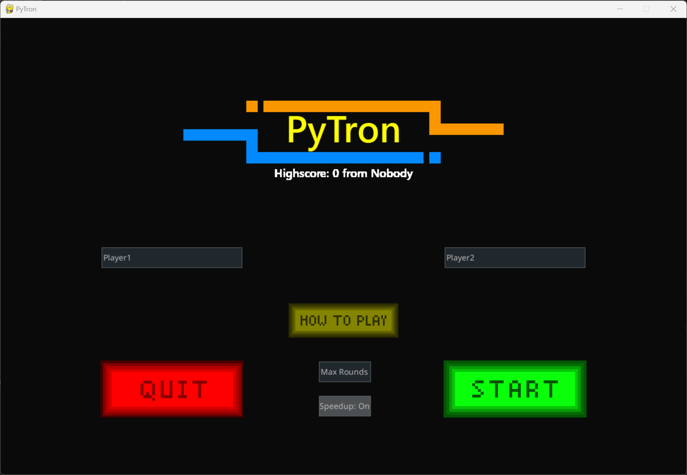
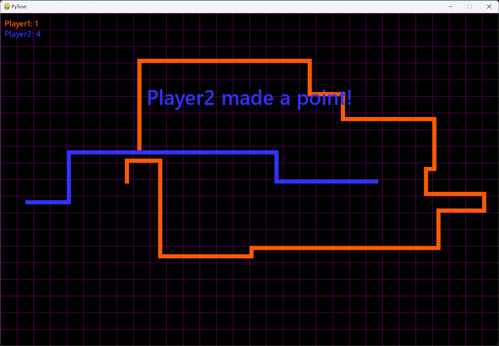

```ascii
  _____    _______              
 |  __ \  |__   __|             
 | |__) _   _| |_ __ ___  _ __  
 |  ___| | | | | '__/ _ \| '_ \ 
 | |   | |_| | | | | (_) | | | |
 |_|    \__, |_|_|  \___/|_| |_|
         __/ |                  
        |___/ 
```
# PyTron

Pytron is a python version of the arcade game tron with some extra features.


## Features
    - Chooseable Playernames
    - Chooseable amount of rounds
    - Score counter
    - The game gets faster on death
    - Main menu
    - Pause menu
    - Death-stats
    - Permanent stored Highscore
    - Little easteregg to discover


## Installation

### **This game requires Python 3.x and has been tested only on Windows!**
1. Download PyTron with git

```bash
   git clone https://github.com/FGDHC1/PyTron.git
   cd pytron
```
2. Install the necessary tools
```bash
pip install pygame pygame_gui
```
3. Run the game
```bash
python Tron.py
```
## Preview




## Authors

- [@FGDHC1](https://github.com/FGDHC1)

## Sources
- [Pygame documentation](https://www.pygame.org/docs/)
- [How to make a Pause funtion](https://pythonprogramming.net/pause-game-pygame/)
- [Playermovement](https://www.geeksforgeeks.org/snake-game-in-python-using-pygame-module/)
- [How to add Buttons](https://www.youtube.com/watch?v=G8MYGDf_9ho)
- [Pygame_gui documentation](https://pygame-gui.readthedocs.io/en/latest/)
- [How to make textinputs](https://www.youtube.com/watch?v=kDSdjsdoGOY&t=89s)


## License

MIT License

Copyright (c) 2024 FGDHC1

Permission is hereby granted, free of charge, to any person obtaining a copy
of this software and associated documentation files (the "Software"), to deal
in the Software without restriction, including without limitation the rights
to use, copy, modify, merge, publish, distribute, sublicense, and/or sell
copies of the Software, and to permit persons to whom the Software is
furnished to do so, subject to the following conditions:

The above copyright notice and this permission notice shall be included in all
copies or substantial portions of the Software.

THE SOFTWARE IS PROVIDED "AS IS", WITHOUT WARRANTY OF ANY KIND, EXPRESS OR
IMPLIED, INCLUDING BUT NOT LIMITED TO THE WARRANTIES OF MERCHANTABILITY,
FITNESS FOR A PARTICULAR PURPOSE AND NONINFRINGEMENT. IN NO EVENT SHALL THE
AUTHORS OR COPYRIGHT HOLDERS BE LIABLE FOR ANY CLAIM, DAMAGES OR OTHER
LIABILITY, WHETHER IN AN ACTION OF CONTRACT, TORT OR OTHERWISE, ARISING FROM,
OUT OF OR IN CONNECTION WITH THE SOFTWARE OR THE USE OR OTHER DEALINGS IN THE
SOFTWARE.

