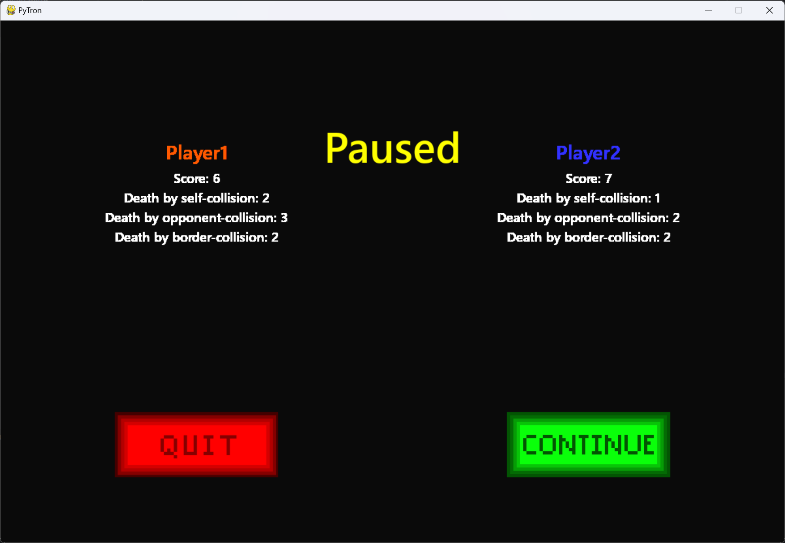

```ascii
  _____    _______              
 |  __ \  |__   __|             
 | |__) _   _| |_ __ ___  _ __  
 |  ___| | | | | '__/ _ \| '_ \ 
 | |   | |_| | | | | (_) | | | |
 |_|    \__, |_|_|  \___/|_| |_|
         __/ |                  
        |___/ 
```
# PyTron

Pytron is a python version of the arcade game tron with some extra features.


## Features
    - Chooseable Playernames
    - Chooseable amount of rounds
    - Score counter
    - The game gets faster on death
    - Main menu
    - Pause menu
    - Death-stats
    - Permanent stored Highscore
    - Little easteregg to discover


## Installation

### **This game requires Python 3.x and has been tested only on Windows!**
1. Download PyTron with git

```bash
git clone https://github.com/FGDHC1/PyTron.git
cd pytron
```
2. Run the game
```bash
cd PyTron
```
## Preview




## Authors

- [@FGDHC1](https://github.com/FGDHC1)


## Sources
- [Pygame documentation](https://www.pygame.org/docs/)
- [How to make a Pause funtion](https://pythonprogramming.net/pause-game-pygame/)
- [Playermovement](https://www.geeksforgeeks.org/snake-game-in-python-using-pygame-module/)
- [How to add Buttons](https://www.youtube.com/watch?v=G8MYGDf_9ho)
- [Pygame_gui documentation](https://pygame-gui.readthedocs.io/en/latest/)
- [How to make textinputs](https://www.youtube.com/watch?v=kDSdjsdoGOY&t=89s)


## License

Copyright (c) 2024-2026 FGDHC1

This project is licensed under the [MIT License](LICENSE).

